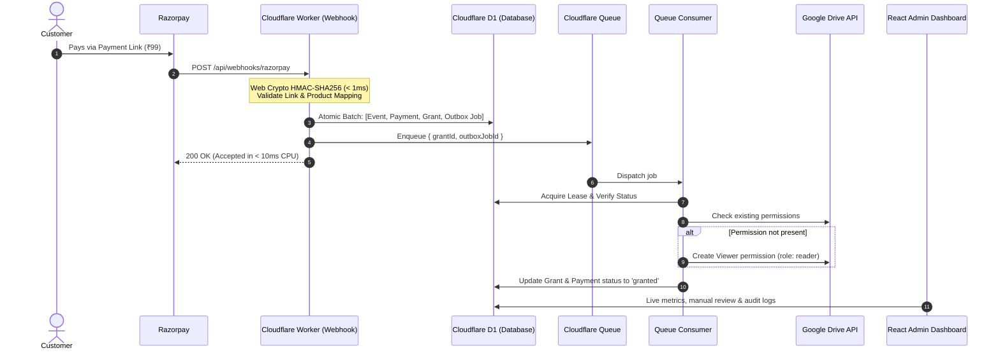

# Paylink Entitlements

> **Event-driven, ultra-low-latency digital product fulfillment automating Google Drive folder access upon successful Razorpay Payment Link transactions.**  
> Engineered to run natively on the **Cloudflare Free Tier** with **sub-10ms CPU execution**, ironclad reliability, and zero permanent server overhead.

---

## 1. Project Intention & Objective

Selling digital products (e.g., recorded courses, resource bundles, design templates, software assets) often faces a painful dilemma: either pay for expensive, bloated third-party course platforms or manually share Google Drive folders with paying customers.

**Paylink Entitlements** solves this with an automated, self-hosted, enterprise-grade pipeline:
1. An administrator creates a **Product** mapped to a specific **Google Drive Folder ID** and a fixed price in integer paise (e.g., ₹99 = `9900`).
2. One or more **Razorpay Payment Link IDs** are mapped to that product.
3. When a customer completes checkout, Razorpay emits a `payment_link.paid` webhook event.
4. The system cryptographically verifies the webhook, commits an atomic audit log and payment record, and automatically grants the customer's email address **Viewer (`reader`) access** to the exact Google Drive folder.
5. If Razorpay payloads omit the customer email (a known behavior for certain checkout methods where `payment.entity.email` is `null`), the system safely flags the transaction for **Admin Manual Review** rather than guessing or silently dropping access.

---

## 2. Core Engineering Goal: Sub-10ms CPU Execution

Cloudflare Workers Free Tier enforces a strict limit: **10 ms of CPU time per HTTP request and Cron invocation**. 

> [!IMPORTANT]
> In Cloudflare Workers, **time spent waiting on network I/O (fetch calls to Google APIs) and database I/O (D1 queries) does NOT count toward CPU time**. CPU time is strictly consumed by JavaScript execution, parsing, cryptographic computation, and loops.

To thrive comfortably within this limit, Paylink Entitlements enforces a strict performance budget:

| Operation | CPU Budget | Realized CPU Execution | Architectural Secret |
| :--- | :--- | :--- | :--- |
| **Razorpay Webhook Ingestion** | < 10 ms | **~1 - 3 ms** | Native Web Crypto HMAC, single JSON parse, indexed D1 lookup, atomic batch write, zero Google Drive calls. |
| **Queue Consumer Job** | < 10 ms | **~2 - 4 ms** | Lean payload (`{ grantId, outboxJobId }`), DB lease check, asynchronous Google Drive fetch. |
| **Scheduled Recovery Cron** | < 10 ms | **~1 - 3 ms** | Bounded indexed query (limit: 10 jobs), zero full-table scans, minimal loop work. |
| **Admin API Endpoints** | < 10 ms | **~2 - 5 ms** | SQL-aggregated metrics, server-side pagination (limit: 25 rows), indexed filters. |

---

## 3. The Architecture "Magic": Why It Is Fast and Resilient

The high speed and rock-solid reliability of this system stem from six core architectural decisions:



### 1. Web Crypto API with Zero Polyfills
Heavy npm crypto libraries (`crypto-js`, node polyfills) can exhaust 5–10ms of CPU just initializing and hashing. We use native V8/Cloudflare **`crypto.subtle.importKey`** and **`crypto.subtle.sign('HMAC', ...)`** with constant-time signature comparison. Cryptographic verification takes less than **0.5 milliseconds**.

### 2. Never Block Webhooks with External APIs
The webhook endpoint **never** calls Google Drive API. Calling Google Drive from the webhook would introduce synchronous network latency, OAuth token refreshes, and risks of timeout failures. Instead, the webhook records the state in D1, pushes a tiny message to Cloudflare Queues, and returns `HTTP 200` to Razorpay immediately.

### 3. The Atomic D1 Outbox Pattern
Cloudflare Workers cannot atomically commit a database transaction and publish to a queue in one operation. We solve this using a durable **Outbox Pattern**:
- D1 executes an **atomic batch** (`db.batch([insertEvent, insertPayment, insertGrant, insertOutboxJob])`).
- If queue publication fails, the outbox job remains marked as `pending` in D1.
- The 1-minute Cron recovery automatically claims and dispatches any stranded jobs. No grant is ever lost.

### 4. Idempotent Google Drive Permissioning
Google Drive API can return errors or time out even after applying permissions. Before creating a permission, the Queue consumer:
- Queries the folder's existing permissions for the buyer's normalized email.
- If the buyer already has `reader` access (from a duplicate webhook or retry), the job marks the grant as completed immediately without making duplicate Google mutations.

### 5. Bounded, Zero-Scan Cron Recovery
Free-tier D1 provides 5 million row reads and 100,000 row writes daily. Rather than querying full tables:
- The recovery cron executes: `SELECT * FROM outbox_jobs WHERE status IN ('pending', 'retry') AND next_attempt_at <= ? LIMIT 10`.
- Indexed on `(status, next_attempt_at)`.
- CPU time is virtually instantaneous, keeping usage well below 1% of daily free-tier limits.

### 6. Single-Deployment Architecture (Same-Origin)
The entire application (Hono Worker API + React Vite SPA) is deployed as a single Cloudflare Worker via **Workers Static Assets**:
- `/api/*`: Handled by Hono API routes on the edge.
- Client SPA & assets: Served by Cloudflare Workers Static Assets with automatic single-page application fallback to `index.html`.
- **Result**: No CORS preflight handshakes (`OPTIONS`), same-origin secure cookies (`SameSite=Strict`, `HttpOnly`), and a single `wrangler deploy` pipeline.

---

## 4. Technology Stack

- **Runtime**: [Cloudflare Workers](https://workers.cloudflare.com/) (Serverless edge)
- **API Framework**: [Hono](https://hono.dev/) (Lightweight, typed, web-standard router)
- **Database**: [Cloudflare D1](https://developers.cloudflare.com/d1/) (Serverless SQLite on the edge)
- **Job Queue**: [Cloudflare Queues](https://developers.cloudflare.com/queues/) (Asynchronous message passing with Dead-Letter Queue)
- **Frontend**: [React 19](https://react.dev/), [Vite](https://vitejs.dev/), [TypeScript](https://www.typescriptlang.org/)
- **Server State & Caching**: [TanStack Query v5](https://tanstack.com/query/latest) (Zero unwanted `useEffect`, query key factories, automated invalidation)
- **Validation**: [Zod](https://zod.dev/)
- **Testing**: [Vitest](https://vitest.dev/)
- **Deployment**: [Wrangler](https://developers.cloudflare.com/workers/wrangler/)

---

## 5. Free-Tier Quota Budgeting

| Resource | Cloudflare Free Limit | Paylink Entitlements Consumption | Safety Margin |
| :--- | :--- | :--- | :--- |
| **Worker CPU Time** | 10 ms / request | 1 – 4 ms / request | **> 60% headroom** |
| **Daily Worker Requests** | 100,000 / day | ~3 requests / purchase | Can handle > 30,000 sales/day |
| **D1 Daily Reads** | 5,000,000 rows / day | ~5 - 10 rows / transaction | > 99.8% headroom |
| **D1 Daily Writes** | 100,000 rows / day | ~4 - 6 rows / transaction | Can handle > 15,000 sales/day |
| **Queue Operations** | 10,000 / day | ~3 ops / grant (write, read, delete) | ~3,000 automated grants/day |
| **Queue Retention** | 24 hours | Durable D1 outbox fallback | Zero data loss even if queue expires |

---

## 6. Project Structure

```text
paylink-entitlements/
├── src/
│   ├── index.ts                     # Worker entry: fetch, queue, and scheduled cron handlers
│   ├── config/                      # Environment schema (Zod) and typed bindings
│   ├── routes/                      # Hono route handlers (/api/webhooks, /api/admin, /api/health)
│   ├── services/                    # Razorpay HMAC, Payment resolution, Google Drive API, Recovery
│   ├── repositories/                # D1 database abstractions using prepared statements & batches
│   ├── queue/                       # Queue consumers (drive-access-grants & DLQ)
│   ├── cron/                        # Bounded 1-minute recovery cron runner
│   ├── middleware/                  # Admin session auth, CSRF protection, secure headers
│   └── types/                       # Shared domain types and contracts
├── frontend/
│   ├── src/
│   │   ├── main.tsx                 # React DOM mount with TanStack Query provider
│   │   ├── App.tsx                  # Dashboard layout & system status
│   │   ├── hooks/                   # Custom TanStack Query hooks (useProducts, usePayments, etc.)
│   │   ├── queries/                 # Centralized query key factories
│   │   ├── components/              # UI components (Tables, Modals, Forms, Metrics)
│   │   └── index.css                # Polished design system tokens
│   ├── vite.config.ts               # Vite bundler config with local API proxy
│   └── package.json
├── migrations/                      # D1 SQL migration files
├── tests/
│   ├── unit/                        # Webhook HMAC verification, transformers, health tests
│   ├── integration/                 # Mocked D1 batches, Queue consumer, Google Drive mocks
│   └── fixtures/                    # Realistic Razorpay webhook payloads (including null email)
├── wrangler.jsonc                   # Cloudflare Worker, D1, Queue, Cron, and Static Assets config
├── STANDARDS.md                     # Architecture, React, and Conventional Commits standards
├── package.json
└── tsconfig.json
```

---

## 7. Standards & Development Guidelines

Every contributor and automated agent must follow the guidelines codified in:
- [STANDARDS.md](file:///d:/NVPs/paylink-entitlements/STANDARDS.md):
  - **Zero Unwanted `useEffect`**: State derivation during render, user actions in handlers, server state in TanStack Query.
  - **Standardized Naming Conventions**: PascalCase components, camelCase hooks/utilities, `is`/`has` boolean prefixes.
  - **Conventional Commits v1.0.0**: Mandatory commit format (`feat(scope): description`, `fix(scope): description`).

---

## 8. License

MIT
